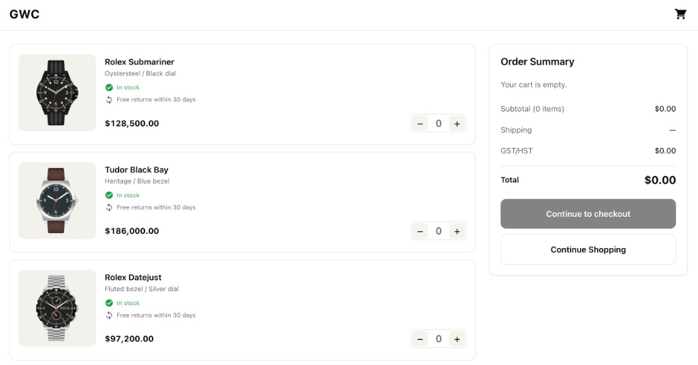

# GWC Shop



## Overview

- Frontend: React + TypeScript
- Backend: Node.js (Checkout session creation)
- Payments: Stripe Checkout

Features: add items, change quantity (0 removes the line), order summary, checkout.

## Cart

Cart state is shared through `useContext` (`CartProvider` in `src/context/CartContext.tsx`) to avoid props drilling, since the cart is read from several places. The provider delegates all updates to `src/cart/cartLogic.ts`, so cart rules are defined in one place.

## Checkout

The client sends only `{ id, quantity }`. The server resolves prices from `shared/catalog.ts` and builds the Stripe line items, so prices cannot be changed from the client. Unknown ids and non-positive or non-integer quantities are rejected. `STRIPE_SECRET_KEY` is read from `.env`, which is gitignored.

## Performance

Images use WebP to reduce file size, with explicit dimensions and `loading="lazy"` to prevent layout shift. If the catalog grows, the first change would be splitting the cart context into state and actions, so the header does not re-render on every update.

## Estimates of Time Taken

2 hours (Same as technical test)

AI was used for:

- Investigating the causes of errors
- Identifying test cases, including edge cases
- Styling adjustments
- Parts of the Stripe Checkout integration
- Code review

## Improvements

- Fixed the bug pointed out in the interview: adding an item already in the cart created a new line instead of increasing its quantity.
- Moved cart state from page-level `useState` into a context.
- Added Stripe Checkout with server-side price lookup.

## How to Run

```bash
pnpm install
cp .env.example .env   # set STRIPE_SECRET_KEY (test key)
pnpm dev
```

Run tests:

```bash
pnpm test
```
